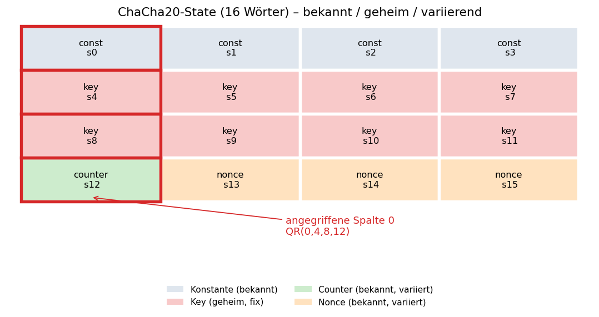
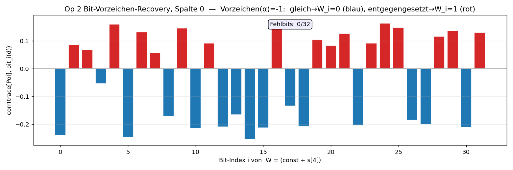
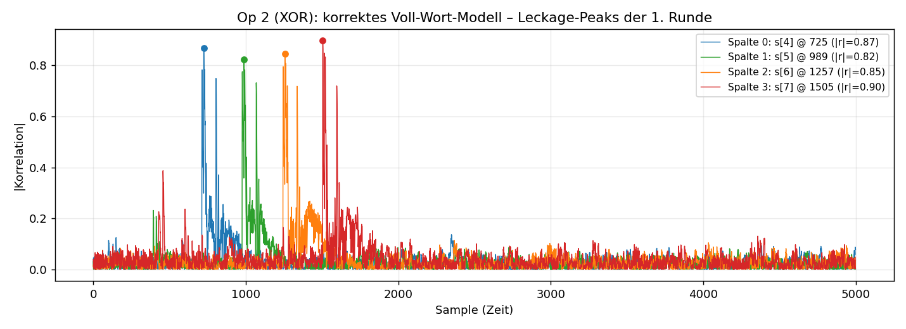
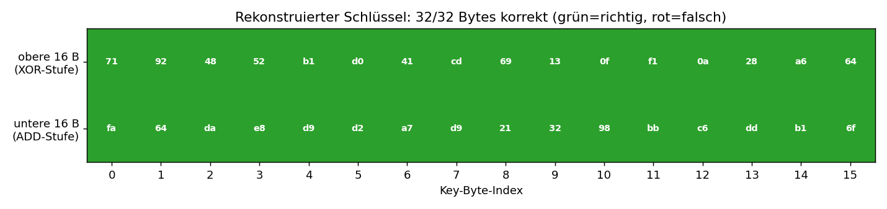
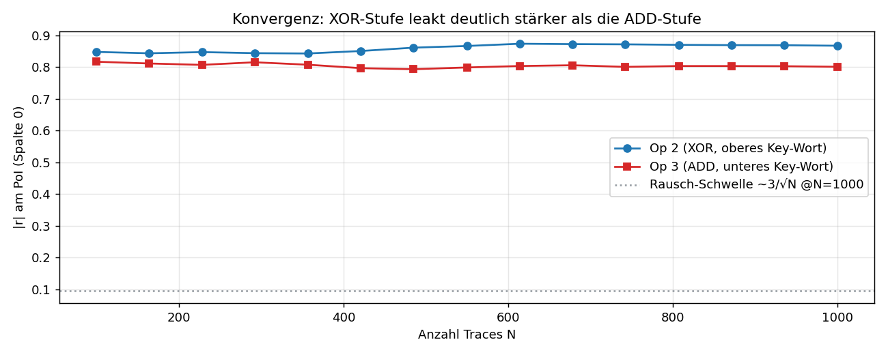

# CPA auf ChaCha20 — Funktionsweise & Visualisierung

Begleitdokument zu [`ChaCha20 - Test (HARDWARE).ipynb`](./ChaCha20%20-%20Test%20(HARDWARE).ipynb),
Sektion **7 (CPA-Angriff)**. Es erklärt, *warum* der Angriff funktioniert, *wie* das
Leckage-Modell aufgebaut ist und *wo* die Grenzen bei 1000 Traces liegen.

Ziel: aus Stromverbrauchs-Traces eines STM32 (ChipWhisperer-Lite) den geheimen
256-bit-ChaCha20-Schlüssel zurückgewinnen — ohne S-Box, rein über die ARX-Operationen
(**A**dd / **R**otate / **X**OR).

---

## 1. Angriffspunkt im ChaCha20-State

ChaCha20 arbeitet auf 16 32-bit-Wörtern. Die erste Runde ("Spaltenrunde") rechnet
vier unabhängige Quarter-Rounds `QR(a,b,c,d)`. Entscheidend ist, *welche* Wörter
bekannt/variierend und welche geheim/fix sind:



| Wörter | Rolle | Für CPA |
|---|---|---|
| `s0..s3` | Konstante `"expand 32-byte k"` | bekannt, fix |
| `s4..s11` | **256-bit-Key** | **geheim, fix → Angriffsziel** |
| `s12` | Block-Counter | bekannt, **variiert** |
| `s13..s15` | Nonce (96 bit) | bekannt, **variiert** |

Pro Spalte `j` (0..3) rechnet `QR(j, 4+j, 8+j, 12+j)`. Das **variierende, bekannte**
Wort ist `d = s[12+j]` (Counter bzw. Nonce), die geheimen Key-Wörter sind
`s[4+j]` (oben) und `s[8+j]` (unten).

---

## 2. CPA-Grundidee in einem Satz

> Für jede Schlüssel-Hypothese berechnet man am PC einen **Hamming-Weight (HW)**-Wert
> pro Trace und korreliert diese Hypothesen-Spalte gegen jede Zeit-Spalte der realen
> Traces. **Nur die richtige Hypothese** passt zum tatsächlichen Stromverbrauch →
> hoher Korrelationspeak bei `(richtiger Key, Leckage-Zeitpunkt)`.

Leckage-Modell hier: **Hamming-Weight** (nicht Hamming-Distance), weil die Register
pro Instruktions-Zyklus genullt werden — es dominiert das HW des *geladenen Werts*.
Der Chip leakt dabei das HW des **ganzen 32-bit-Worts**.

Korrelation (Pearson, vektorisiert über alle Zeitpunkte gleichzeitig):

```python
def corr_all(model):            # model:(N,)  ->  r:(S,)
    m = model - model.mean()
    return (m @ Tc) / (sqrt((m**2).sum()) * Tden)   # Tc,Tden aus zentrierten Traces
```

---

## 3. Warum der "naive" Angriffspunkt scheitert

Naheliegend wäre die allererste Addition `x[a] += x[b]` in `QR(0,4,8,12)`:
`x[0] += x[4]` = `const + Key-Wort`. Aber **beide Operanden sind über alle Traces
konstant** (Key fix, Konstante fix) → die Hypothesen-Spalte wäre konstant → Korrelation
undefiniert. **Nicht angreifbar.**

Die nötige Varianz kommt *nur* vom variierenden Counter/Nonce. Der **erste angreifbare
Zwischenwert** ist deshalb die zweite Operation der QR:

```
x[d] = rotl32( x[d] ^ x[a], 16 )      mit x[a] = (const + Key-Wort)
```

Da HW **rotationsinvariant** ist (`HW(rotl(v)) = HW(v)`), gilt für Spalte 0:

```
Leckage  =  HW( counter  XOR  W )        mit  W = (0x61707865 + s[4]) mod 2³²
```

---

## 4. Stufe 1 — obere Key-Wörter `s[4..7]` (XOR, Bit-Vorzeichen)

Weil die Leckage ein **reines XOR** mit dem bekannten `d` ist, sind alle 32 Bit
*unabhängig* (kein Carry). Für Bit `i` gilt `sum_i = d_i ⊕ W_i`:

- `W_i = 0` → Modellbit folgt `d_i`   → Korrelation hat das **Leckage-Vorzeichen α**
- `W_i = 1` → Modellbit folgt `¬d_i`  → Korrelation hat das **entgegengesetzte** Vorzeichen

Also verrät schon das **Vorzeichen** von `corr(trace[PoI], bit_i(d))` jedes einzelne Bit
von `W` — und zwar unter Einsatz *aller* Traces pro Bit (hohes SNR). Danach
`s[4+j] = (W − const) mod 2³²`.



Jeder Balken ist ein Bit von `W`. Das Vorzeichen (hier α = −1, Leckage ist negativ)
trennt sauber: blau = `W_i=0`, rot = `W_i=1`. **0/32 Fehlbits** → oberes Key-Wort exakt.

> Warum nicht die klassische „256-Hypothesen-pro-Byte"-CPA? Weil der Chip das HW des
> *ganzen* Worts leakt: ein 8-Bit-Byte-Modell beschreibt nur 8 von 32 Bit, die anderen
> 24 Bit sind Rauschen → bei 1000 Traces zu schwach. Das Bit-Vorzeichen-Verfahren nutzt
> den vollen Leck-Effekt und ist deshalb hier robuster.

---

## 5. Point-of-Interest (PoI)

Der Leckage-Zeitpunkt wird *nicht* vorgegeben, sondern von der Korrelation selbst
gefunden. Das volle Voll-Wort-Modell (einmaliges Profiling mit bekanntem Testkey)
liefert pro Spalte einen scharfen Peak:



Die vier Spalten-QRs laufen zeitlich gestaffelt (Samples ~725 / 989 / 1257 / 1505),
mit |r| ≈ 0.82–0.90 — eindeutige, isolierte Leckage der ersten Runde. An genau diesen
PoIs wird anschließend Bit für Bit ausgewertet.

---

## 6. Stufe 2 — untere Key-Wörter `s[8..11]` (ADD mit Carry)

Die dritte Operation `x[c] += x[d]` mischt das zweite Key-Wort ein:

```
Leckage  =  HW( s[8+j]  +  d2 )     mit  d2 = rotl32(d ⊕ W, 16)   (aus Stufe 1 bekannt)
```

Das ist eine **echte 32-bit-Addition** → Bits sind über den **Carry** gekoppelt.
Man rekonstruiert `a = s[8+j]` bitweise **LSB→MSB**: Summen-Bit `i` ist `a_i ⊕ k_i`
mit `k_i = b_i ⊕ carry_i`, wobei `carry_i` aus den schon bekannten niedrigen Bits
folgt. Damit greift dasselbe Vorzeichen-Prinzip wie bei XOR, nur mit fortgeschaltetem
Carry:

```python
carry = ((a_i & b_i) | (a_i & carry) | (b_i & carry))   # Carry in Bit i+1
```

**Einordnung:** Die ADD-Stufe ist empfindlicher als die XOR-Stufe. Der Chip leakt das
HW des ganzen Worts, und die Carry-Kette verschmiert das Signal über mehrere Bits, das
|r| pro Bit ist niedriger (siehe Konvergenz, §9). Bei diesem Capture reicht **N = 1000**
dennoch für alle vier unteren Wörter; bei einem verrauschteren Capture ist sie die
Stufe, die zuerst mehr Traces verlangt.

---

## 7. Schlüssel zusammensetzen & verifizieren

Die 8 rekonstruierten Wörter `s[4..11]` ergeben den 256-bit-Key. **Unabhängige
Kontrolle** ohne Kenntnis des echten Keys: ein gespeichertes `(pt, ct)`-Paar
nachrechnen (`ct == ChaCha20(rec_key, nonce, ctr) ⊕-Keystream`). Stimmt es, ist der
Key garantiert korrekt — das löst nebenbei die globale Vorzeichen-Ambiguität von α.

---

## 8. Ergebnis bei N = 1000



| Stufe | Key-Material | Ergebnis |
|---|---|---|
| **1 — XOR** (`s4..s7`) | obere 128 bit | **16/16 Bytes exakt** ✅ |
| **2 — ADD** (`s8..s11`) | untere 128 bit | **16/16 Bytes exakt** ✅ |
| gesamt | 256 bit | **32/32 Bytes — voller Schlüssel** ✅ |

Der komplette 256-bit-Schlüssel wird aus 1000 Traces zurückgewonnen; der
Re-Encrypt-Check gegen ein gespeichertes `(pt, ct)`-Paar bestätigt ihn unabhängig.

---

## 9. Wie viele Traces braucht es?



|r| am PoI über der Trace-Zahl. Die XOR-Stufe (Op 2) sättigt früh und hoch; die
ADD-Stufe (Op 3) liegt systematisch darunter — sie ist die kritische Stufe. Hier
genügen 1000 Traces für beide; bei schwächerem SNR die Capture-Zelle mit größerem `N`
(z. B. 4000–5000) laufen lassen, die Analyse-Sektion bleibt unverändert.

Faustregel: nötige Trace-Zahl `n ∼ 1/ρ²` (ρ = Korrelation der richtigen Hypothese).

---

## 10. Zuordnung zum Notebook

| Notebook-Zelle | Inhalt | Dokument |
|---|---|---|
| 7.0 | Daten laden, HW-/Korrelations-Helfer | §2 |
| 7.1 | PoI & Leckage-Vorzeichen (Profiling) | §5 |
| 7.2 | Stufe 1: `recover_xor` → `s[4..7]` | §4 |
| 7.3 | Stufe 2: `recover_add` → `s[8..11]` | §6 |
| 7.4 | Key zusammensetzen + Re-Encrypt-Check | §7 |
| 7.5 | Konvergenz-Plot | §9 |

Abbildungen liegen in [`cpa_figures/`](./cpa_figures/) und werden von
[`make_cpa_figures.py`](./make_cpa_figures.py) aus denselben Formeln erzeugt, die auch
das Notebook verwendet. Nach einem erneuten Capture (mehr Traces) einfach das Skript
neu laufen lassen — die Abbildungen aktualisieren sich.

---

## 11. Didaktischer Durchgang im Stil der Vorlesung (1–3)

Dieser Abschnitt rekapituliert den Angriff entlang des **allgemeinen CPA-Rezepts aus
Vorlesung 3** und begründet jeden Schritt. Er zeigt, *was* aus der Vorlesung direkt
übernommen wird und *wo* ChaCha20 (ARX, keine S-Box) eine eigene Herleitung erzwingt.

**Was aus den drei Vorlesungen einfließt:**

→ **Vorlesung 1** — Leckage-Physik: CMOS verbraucht beim Schalten Strom, deshalb hängt
  der Verbrauch von den Daten ab. Einfaches Modell: **Hamming-Weight (HW)** / Hamming-
  Distance (HD).
→ **Vorlesung 2** — Statistik: Messung = Nutzsignal + normalverteiltes Rauschen; der
  Zusammenhang Modell ↔ Messung wird mit **Pearsons Korrelationskoeffizient** `r`
  gemessen (`−1 ≤ r ≤ 1`, Vorzeichen = Richtung). CPA-Idee: die richtige Hypothese
  korreliert am stärksten.
→ **Vorlesung 3** — das **5-Schritt-Rezept** (unten) plus der zentrale Hinweis, dass der
  Angriffspunkt **implementierungsspezifisch angepasst** werden muss.

### Das Rezept (Vorlesung 3) und seine Anwendung

**Schritt 1 — Geeigneten Zwischenwert wählen.**

→ Vorlesungsregel: ein Zwischenwert, der (a) nur von einem **Teil** des Keys abhängt
  (sonst 2¹²⁸ Hypothesen), (b) aus **bekannter Ein- oder Ausgabe** berechenbar ist, und
  (c) möglichst **nichtlinear** von Key und Input abhängt.
→ Warum nichtlinear? Die Vorlesung zeigt an AES: Greift man direkt die **lineare**
  Schlüsseladdition an (XOR), sind wegen der XOR-Symmetrie **mindestens zwei
  Hypothesen gleich wahrscheinlich**. Bei AES löst das die nichtlineare **S-Box**.
→ **ChaCha hat keine S-Box.** Die einzige Nichtlinearität in ARX ist die **modulare
  Addition**. Unser erster angreifbarer Zwischenwert ist deshalb Op 2 der Quarter-Round,
  `HW(d ⊕ (const + s[4+j]))` (§3), die unteren Wörter später über die Addition Op 3 (§6).
→ Teil-Key statt Gesamt-Key: wir greifen **ein 32-bit-Wort pro Spalte** an, byte-/
  bitweise — nie den ganzen 256-bit-Key auf einmal.
→ Die von der Vorlesung gewarnte Komplement-Ambiguität taucht hier real als **globales
  α-Vorzeichen** auf (§7) — wir lösen sie erst ganz am Ende per Re-Encryption.

**Schritt 2 — Modell wählen.**

→ Vorlesungsregel: HW oder HD genügen für dieses Target.
→ Wir nehmen **HW**, nicht HD. Warum? Die Register werden pro Instruktions-Zyklus
  effektiv genullt, also zählt das HW des **frisch geladenen Werts**, nicht die Distanz
  zum Vorwert. (Hätte das Target stattdessen alte Registerinhalte überschrieben, wäre
  HD das richtige Modell — das ist der Unterschied, den Vorlesung 1 benennt.)
→ **Feinheit:** Der Chip leakt das HW des **ganzen 32-bit-Worts**, nicht eines einzelnen
  Bytes — das wird in Schritt 4 entscheidend.

**Schritt 3 — Messen (n Traces, n verschiedene Eingaben).**

→ Vorlesungsregel: **fester Key, n zufällige Klartexte**, 500–100 000 Traces.
→ **ChaCha-Besonderheit:** Der Klartext hilft *nicht* — er wird erst ganz am Ende mit
  dem fertigen Keystream ge-XORt und berührt die erste Runde nicht. Die variierende
  **bekannte** Größe ist stattdessen **Counter/Nonce im State** (`s12..s15`).
→ Warum muss überhaupt etwas variieren? Vorlesung 2: Ist die Modellspalte **konstant**,
  ist ihre Varianz 0 und `r` undefiniert — genau deshalb scheitert der „naive"
  Angriffspunkt `const + key` (§3). Counter/Nonce liefern die nötige Streuung.
→ Unser Datensatz: **1000 Traces × 5000 Samples**, fester Key, pro Trace neuer
  zufälliger Counter + Nonce (+ Klartext, nur für die Ground-Truth-Kontrolle).

**Schritt 4 — Hypothetische Zwischenwerte berechnen.**

→ Vorlesungsregel (AES): 8-bit-Subkey → **256 Hypothesen**, je das HW des
  Zwischenwerts.
→ Wir weichen hier bewusst ab. Warum? Weil der Chip das **Voll-Wort-HW** leakt, hätte
  ein 8-Bit-Byte-Modell 24 von 32 Bit als Rauschen → bei 1000 Traces zu schwach (§4,
  grauer Kasten). Stattdessen das **Bit-Vorzeichen-Verfahren**: Da die Leckage für die
  XOR-Stufe `HW(d ⊕ W)` ist, verrät das **Vorzeichen** von `corr(trace, bit_i(d))`
  jedes Bit von `W` einzeln — unter Einsatz *aller* Traces pro Bit. Für die ADD-Stufe
  dasselbe Prinzip bitweise LSB→MSB mit fortgeschaltetem **Carry** (§6).
→ Das ist kein Widerspruch zur Vorlesung, sondern eine an die ARX-/Voll-Wort-Leckage
  angepasste Variante desselben Grundgedankens „Hypothese → HW-Modell".

**Schritt 5 — Pearson-Korrelation rechnen.**

→ Vorlesungsregel: für jeden Zeitpunkt die Korrelation Modell ↔ Messung; die richtige
  Hypothese sticht heraus.
→ Umsetzung: `corr_all` (§2) rechnet alle 5000 Zeitpunkte **vektorisiert** in einem
  Schritt. Der **Point-of-Interest** ist das Sample mit maximalem `|r|` (§5); die vier
  Spalten-QRs liegen zeitlich gestaffelt bei ~725/989/1257/1505.

**Finaler Schritt — Interpretieren & verifizieren.**

→ Vorlesung 2/3: `r` ist bei wenig Traces nur ein **Schätzwert** (Rauschen), deshalb
  kann eine richtige Hypothese unter- oder eine falsche überschätzt werden.
→ Wir machen die Bewertung daher **hart statt per Rang**: Key zusammensetzen und per
  **Re-Encryption** gegen ein gespeichertes `(pt, ct)`-Paar prüfen (§7). Stimmt es, ist
  der Key garantiert korrekt — und die α-Vorzeichen-Ambiguität aus Schritt 1 ist gelöst.

### Begründung der Trace-Zahl (Vorlesung 2/3)

→ Vorlesung: Zahl der Traces so lang erhöhen, bis sich die richtige Hypothese **klar
  abhebt**; grober Bereich 500–100 000. Rauschen mittelt sich mit mehr Traces heraus
  (SNR steigt).
→ Bei uns: Die XOR-Stufe ist schon bei 1000 Traces sehr klar getrennt (§4, §9). Die
  **ADD-Stufe** hat niedrigeres `|r|` (Carry verschmiert das Bit-Signal) und ist die
  kritische Stufe — genau der von der Vorlesung beschriebene „zu wenige Traces →
  Schätzung von µ unsicher"-Effekt. Auf diesem Capture reichen 1000 Traces für **beide**
  Stufen (32/32, §8); bei schwächerem SNR verlangt die ADD-Stufe zuerst mehr. Faustregel
  `n ∼ 1/ρ²` (§9).

### Kurz: Was ist Vorlesung, was ist eigene Herleitung?

| Baustein | Quelle |
|---|---|
| HW-Modell, Pearson, 5-Schritt-Rezept, PoI, „mehr Traces bei schlechtem SNR" | Vorlesung 1–3 (direkt übernommen) |
| XOR ist linear → Komplement-/Vorzeichen-Ambiguität | Vorlesung 3 (an AES gezeigt), bei uns als α-Sign |
| **Modulare Addition als nichtlinearer Angriffspunkt** (keine S-Box) | eigene Herleitung für ChaCha |
| **Counter/Nonce** statt Klartext als variierende Bekannte | eigene Herleitung für ChaCha |
| **Bit-Vorzeichen** statt 256-Byte-Hypothesen (Voll-Wort-Leckage), **Carry**-Rekonstruktion | eigene Anpassung an ARX |
| Verifikation per Re-Encryption, α-Auflösung | eigene Umsetzung |
